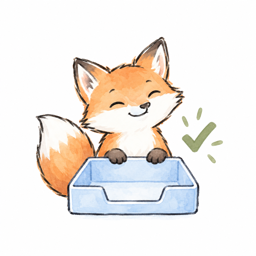
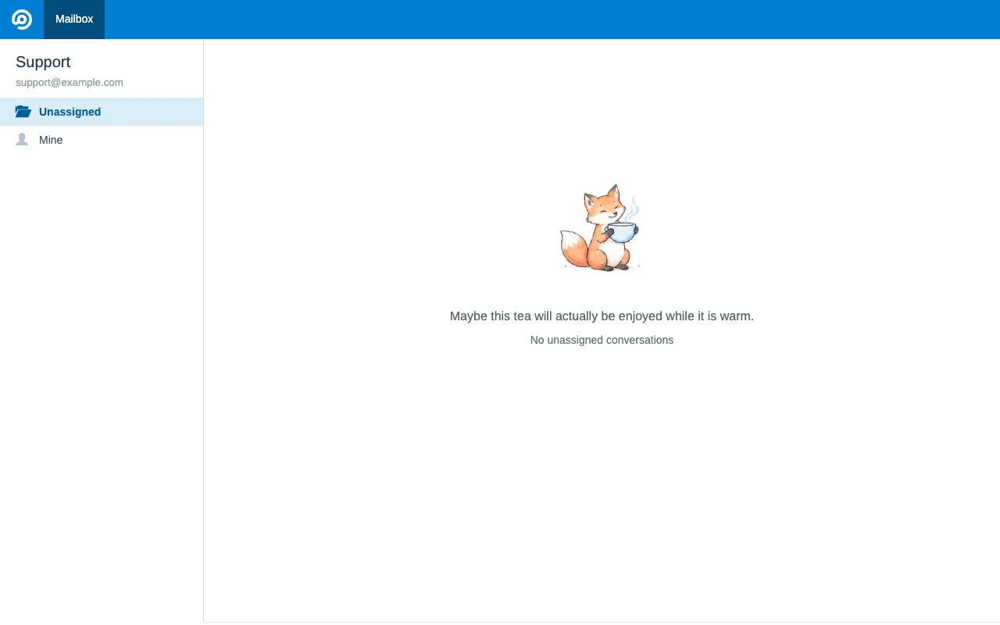
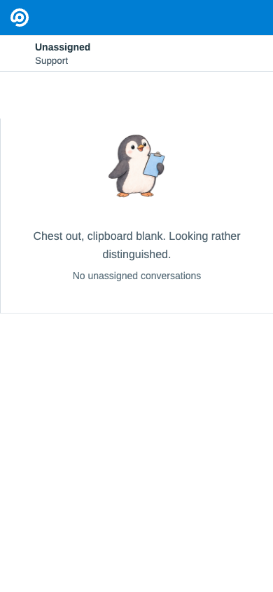

# Inbox Zero



A quiet empty-state replacement for FreeScout's **Unassigned** folder: 100 small,
transparent animal illustrations with English and German sayings. No animation,
sound, buttons, scores, external requests, scheduled jobs or database migrations.

## Screenshots

English previews rendered with FreeScout's conversation table, the module's
illustrations and real CSS. These are isolated fixtures with sample mailbox
details, not screenshots of customer conversations.

**Desktop — a quiet moment with the fox**



**Mobile — a proud penguin**



The examples show two different days' animals. On the same calendar day, everyone
sees the same animal regardless of screen size or language.

## Installation

1. Download `InboxZero.zip` from the [latest release](https://github.com/obstschale/freescout-inbox-zero/releases/latest).
   Extract it into your FreeScout `Modules` directory, resulting in `Modules/InboxZero/module.json`.
2. Enable **InboxZero** under **Manage → Modules**. FreeScout publishes the module's
   `Public` assets at `/modules/inboxzero` when activating it.
3. Open each desired mailbox's **Settings**, check **Enable InboxZero for this mailbox**
   and save. The checkbox is off by default, including for existing mailboxes after updating.
4. Open an empty Unassigned folder. Other folders and searches keep their original
   empty state. Disable the module to restore the standard checkmark everywhere.

Alternatively, clone this repository into `Modules/InboxZero`.

Only users allowed to update mailbox settings can change this preference. It is
stored in the mailbox's existing metadata; no database migration is needed.
Unchecking it restores the standard empty state for that mailbox without affecting
other mailboxes. Saving a signature-only form does not reset the preference.

The module uses a Laravel view composer because FreeScout's empty-list partial
has no dedicated module hook. It does not modify or replace any core source file.
Test the integration after FreeScout upgrades that change the conversation table.

## GitHub updates and releases

FreeScout checks the latest stable GitHub release using these `module.json` fields:

```json
{
    "latestVersionUrl": "https://github.com/obstschale/freescout-inbox-zero/releases/latest/download/module.json",
    "latestVersionZipUrl": "https://github.com/obstschale/freescout-inbox-zero/releases/latest/download/InboxZero.zip"
}
```

Both assets are public and must come from the same tagged commit. The ZIP contains
an `InboxZero/` root directory, unlike GitHub's automatic source archives. Using
release assets instead of `main` keeps unreleased changes out of update checks.
See [CHANGELOG.md](CHANGELOG.md) for release notes.

For maintainers, generate `CHANGELOG.md` with `changelogger release <tag>`, commit
the version and documentation changes, and tag that commit. Build the release
assets outside the working tree:

```sh
git archive --format=zip --prefix=InboxZero/ --output=/tmp/InboxZero.zip v0.1.0
git show v0.1.0:module.json > /tmp/module.json
```

Upload both files to the matching stable release. For later releases, substitute
the new tag in both commands and increment `version` in `module.json`.

## One animal per calendar day

The shared `config('app.timezone')` / `APP_TIMEZONE` determines midnight, not a
colleague's profile, language or browser timezone. Configure `APP_TIMEZONE=Europe/Berlin`
if that is your team's day boundary, following FreeScout's configuration/cache
procedure. All application servers must use the same timezone and module version.

The fixed 100-day rotation starts with the fox on 2026-01-01, includes leap days,
and does not reset at New Year. Every animal appears once before the cycle repeats.
Do not reorder `DailyAnimal::ANIMALS` when translating the module.

The animal is selected on each page render, including AJAX folder pagination.
An already-open page does not switch at midnight until it reloads or refreshes.
All mailboxes share the daily animal. Only the visible text follows the user's language.

An empty page of a nonempty paginator is not Inbox Zero. Filtered results and users
restricted to seeing their own assigned conversations retain the original state.
Other modules' custom visibility filters still apply; this module does not bypass
FreeScout permissions or inspect conversations hidden from the current viewer.

## Translations

Translations live in `Resources/lang/en/messages.php` and `Resources/lang/de/messages.php`.
To add a language, copy the English file to `Resources/lang/<FreeScout-locale>/messages.php`
and translate the values. Preserve the keys and all 100 animal slugs. The locale
must also be available in FreeScout. Laravel's configured fallback locale is used
for missing translations (English in a standard installation).

Examples of stable translation keys:

```php
__('inboxzero::messages.empty');
__('inboxzero::messages.animals.fox.name');
__('inboxzero::messages.animals.fox.message');
```

Animal names are used as image alternatives. The joke and inbox status are HTML
text, not baked into images. They wrap on narrow screens. No animation or focus
changes are introduced; the component uses a polite status region.

## Illustrations

`Public/images/animals/<slug>.png` contains the 100 individual transparent PNGs.
Only today's image is requested, not a sprite sheet or the whole collection.
The assets were generated with Amp Painter for this module in four 25-animal sheets
plus individual tiger and armadillo refinements, then cropped, normalized to
300 × 280 pixels and checked over light and dark backgrounds. They are bundled locally;
generation tools are not runtime dependencies. The style is fine sketch contours
with light watercolor and small props.

The collection mixes 50 original relaxed scenes with 50 livelier replacements:
open-eyed curiosity, pride, delight, enthusiasm, affection and playful movement.
The replacements were generated in two further 25-animal sheets with an individual
moose refinement. Their English and German sayings match the new poses and props.
The animal order and translation keys stay unchanged; no emotion selection or
additional interaction is introduced.

## Verification and component preview

Run from the FreeScout root using a PHP version supported by your installation:

```sh
php vendor/bin/phpunit --no-configuration --bootstrap vendor/autoload.php Modules/InboxZero/Tests/InboxZeroTest.php
php -S 127.0.0.1:8097 Modules/InboxZero/Tests/preview.php
```

The tests and preview boot an isolated Laravel view stack, without loading `.env`,
cached application configuration, a database, mail transports or other modules.
They use the real core empty-list view, module provider, translations and CSS.
The preview shell is a fixture, not a logged-in FreeScout session.

- `/`: today's animal through the core table integration (German).
- `/?lang=en`: English.
- `/?animal=fox&lang=de`: a specific asset and its translated saying.
- `/?animal=snail&lang=en`: another asset and language.
- `/?folder=mine`: original FreeScout empty state as a control.
- `/?enabled=0`: a mailbox without InboxZero enabled (standard empty state).

The preview mailbox is explicitly opted in unless `enabled=0` is supplied.

Tests cover per-mailbox opt-in, settings permissions and old form input,
folder/AJAX scoping, restricted users, empty pagination, translations,
shared daily selection, midnight, DST, year boundaries, all 100 entries and PNGs.
The production module has no preview route; the preview script only runs under
PHP's development server. Do not expose that server publicly.
